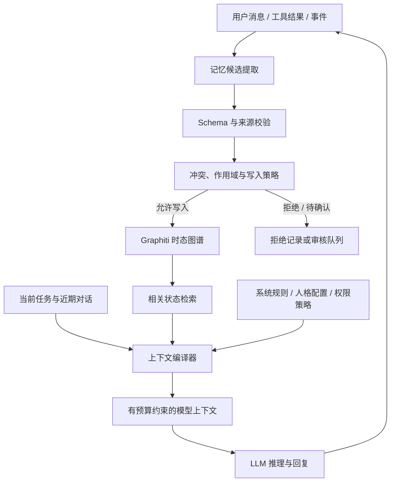

# dsh-graphiti-dls 🧬

> **面向 DeepSeek Harness 的长期记忆与上下文编译插件。**
> 以时态知识图谱管理可追溯的外部状态，并在每轮推理前构建有预算约束的相关上下文。

`dsh-graphiti-dls`（Digital Life System）为长期在线 Agent 提供记忆架构：将值得保留的信息转化为带有来源、作用域和时间信息的结构化事实，根据当前任务选择必要状态，编译为模型可用的上下文。

项目计划复用 [Graphiti](https://github.com/getzep/graphiti) 作为时态知识图谱后端，通过独立适配层接入 `deepseek-harness`，定义适用于 Agent 的**记忆生命周期、可信写入策略和上下文编译规则**。

## 为什么需要 DLS？

长期在线的 Agent 通常会遇到几类问题：

- **上下文预算有限**：历史对话不断增长，无法在每轮推理中完整携带所有内容。
- **摘要存在信息损失**：摘要可以缩短历史，但可能遗漏细节、混淆时间或保留过期决策。
- **事实会随时间变化**：用户偏好、项目方案和任务状态都可能被修正，系统需要区分“过去成立”与“当前成立”。
- **记忆需要可追溯**：当 Agent 回忆错误时，需要知道事实来自哪里、何时记录，以及如何撤销或修正。
- **记忆本身也是安全边界**：来自用户、外部网页和工具输出的内容写入记忆后，不提升其可信级别，也不授予执行权限。

DLS 的目标是在持续增长的外部状态与有限的单轮推理上下文之间，建立一个可检查、可评估的中间层。

## 设计目标

1. **有界上下文（Bounded Context）**：为单轮推理设置明确的输入预算，避免记忆注入量随历史轮数无约束增长。
2. **时态状态（Temporal State）**：区分事实在现实世界中的有效时间，以及系统记录或修正该事实的时间。
3. **可追溯与可纠错（Traceable & Correctable）**：尽可能为持久化事实保留来源、作用域和变更记录，支持检查、修正与删除。
4. **受控写入（Controlled Writes）**：将模型抽取结果视为候选事实，只有通过策略校验后才能进入可被后续推理使用的记忆状态。
5. **职责分离（Stateless Inference, Stateful Edge）**：模型负责理解和推理；外部服务负责状态保存、检索、版本管理和上下文组装。
6. **可量化评估（Measurable Quality）**：用事实召回、状态更新、安全测试、Token 使用量、端到端延迟和总成本评估系统，而不只依赖主观体验。

## 核心架构



### 组件职责

| 组件 | 主要职责 | 关键约束 |
|---|---|---|
| DSH 插件适配层 | 接收事件、读取上下文、提交候选记忆 | 与 Graphiti 内部实现解耦；明确用户、会话和 Agent 的隔离边界 |
| 记忆提取器 | 从消息或事件中识别候选事实 | 输出仅是候选，不因模型提取成功就自动可信 |
| 写入策略层 | 校验 Schema、来源、作用域、关系类型和写入权限 | 普通记忆不能修改系统规则、权限或工具授权 |
| Graphiti 适配层 | 将 DLS 的逻辑事实映射到图谱后端 | 对底层字段和版本差异进行封装，不把内部数据结构泄漏给 DSH 插件 |
| 检索器 | 根据当前任务检索相关事实及必要的关联信息 | 控制邻居扩展和返回规模，避免无关关系泛滥 |
| 上下文编译器 | 对规则、近期对话和检索事实排序、裁剪并组装 | 对目标模型使用的 Token 预算进行显式限制，并记录选择原因 |
| 审计与纠错层 | 查看来源、修正事实、追踪变更、执行删除策略 | 支持从错误记忆中恢复，且不把删除操作误当成普通事实更新 |

## 记忆模型

DLS 使用逻辑上的结构化事实模型。实际存储结构由后端适配器映射，不要求与 Graphiti 的内部 Schema 完全一致。固定字段、强一致性业务状态或高频计数等数据继续使用结构化数据库；短期上下文保留在近期对话窗口中。

一个记忆事实至少应表达：

- **主体与关系**：谁或什么，与谁或什么，具有什么关系。
- **作用域**：该事实适用于哪个用户、项目、会话、Agent 或场景。
- **有效时间**：事实在现实语境中何时成立、何时失效；未知时应保留未知，而不是编造时间。
- **记录时间**：系统何时记录、修正或使该记录失效。
- **来源与信任级别**：来自用户陈述、已授权工具、外部内容、模型推断，还是系统确认。
- **状态与置信信息**：如候选、已接受、待确认、已撤销等；置信度用于排序与筛选，不参与权限判断。

### 逻辑数据示例

以下 JSON 说明 DLS 的概念模型：

```json
{
  "subject": { "id": "project:example", "type": "project" },
  "predicate": "uses_backend_language",
  "object": { "id": "technology:nodejs", "type": "technology", "label": "Node.js" },
  "scope": { "project_id": "example" },
  "valid_time": {
    "from": "2026-03-20T00:00:00Z",
    "to": null
  },
  "recorded_time": {
    "from": "2026-03-20T08:30:00Z",
    "to": null
  },
  "source": {
    "type": "user_statement",
    "event_id": "event:123"
  },
  "trust_level": "user_asserted",
  "status": "accepted"
}
```

### 双时态的使用原则

双时态模型用于区分两个不同的问题：

- **有效时间（valid time）**：这条事实在现实世界或业务语境中何时成立？
- **记录时间（transaction / system time）**：系统何时知道、记录或修正了这条事实？

例如，用户在 3 月 20 日告知系统“我从 3 月 15 日起改用 Node.js”。系统可以在 3 月 20 日记录这项信息，同时将其有效时间追溯到 3 月 15 日。之后如果用户更正了日期，系统应保留可理解的修订轨迹，而不是悄悄抹去原有记录。

系统必须区分事实更新、事实补充、作用域差异和真正的矛盾。只有在适用范围明确、更新策略允许时，才应将旧事实标记为失效；不确定时保留为待确认状态。

## 记忆写入流程

建议的写入流程如下：

1. **事件接收**：记录来源类型、所属用户/会话/Agent、事件 ID 与必要的时间元数据。
2. **候选提取**：模型提取可能值得长期保留的事实，并给出对应来源片段或事件引用。
3. **结构校验**：验证字段、类型、关系白名单和数据大小，拒绝任意自由格式的持久化内容。
4. **信任与权限判断**：识别用户陈述、外部引用、工具结果和模型推断。来自某个来源的文字不应自动获得更高权限。
5. **作用域与冲突判断**：检查新旧事实是否指向相同主体、相同关系和相同作用域，并区分补充、纠正与矛盾。
6. **写入或拒绝**：执行幂等写入、待确认、拒绝或人工审核策略，并记录原因。
7. **审计与纠错**：允许查询来源、修正错误、撤销派生事实以及按策略处理删除请求。

### 来源记录与原始文本保留

原始对话全文不作为每轮推理默认注入的长期记忆。是否持久化原始事件是独立的存储与隐私决策：

- 需要审计或复核时，将原始事件存放在有访问控制和保留期限的独立归档中，图谱只保留来源引用和必要元数据。
- 策略要求不保留原文时，在写入前完成脱敏或丢弃处理，并接受可追溯性下降。
- 使用 Graphiti 后端时，验证集成路径对 episode、来源内容及日志的实际保存行为；提示词不注入原文时，仍需确认后端没有持久化原文。

## 上下文编译器

上下文编译器是 DLS 的核心组件之一。它根据当前任务，将不同来源、不同用途的状态整理为受预算约束的上下文。

概念上，一轮推理的输入可以表示为：

```text
模型上下文 = 系统规则与安全策略
           + 当前任务约束
           + 有限的近期对话窗口
           + 与当前任务相关的长期记忆
```

建议的编译步骤：

1. 根据当前任务确定检索查询和作用域。
2. 检索相关事实，并限制图谱邻居扩展的深度和数量。
3. 按相关性、时效性、来源可信程度、任务重要性和冲突状态排序。
4. 对旧事实、不确定事实和外部不可信内容加上来源与状态标记。
5. 为各类上下文分配 Token 预算，按规则裁剪，并保留近期对话所需的局部连贯性。
6. 记录被选中、被裁剪和被排除的事实及原因，便于调试和评估。

### Token 预算

可以为不同类别设置独立预算，例如系统规则、近期对话、稳定偏好、项目状态和任务相关事实。具体预算由目标模型、工具描述长度和任务评测决定。

示例配置：

```yaml
context:
  max_input_tokens: 6000
  memory_budget_tokens: 1800
  recent_turns: 8
  max_graph_hops: 2
  max_facts: 40
  require_provenance: true
```

应使用目标模型对应的 Tokenizer 进行预算计算，并为工具 Schema、系统规则和格式开销预留空间。不同模型、工具定义或近期对话长度变化，都会影响最终可用于记忆的预算。

## 安全模型

持久化记忆是**影响未来推理的不可信数据面**，不构成指令面。

### 基本原则

- **记忆不承载指令**：记忆可以表达“用户偏好简短回答”，但不能通过普通关系覆盖系统规则或安全策略。
- **Schema 校验只保证结构**：JSON Schema 校验证明数据符合结构与类型；事实真实性和授权有效性由来源校验与权限系统判断。
- **来源需要保留**：用户陈述、外部网页、工具返回与模型推断应当能够被区分。
- **权限必须在工具边界检查**：任何工具调用、数据访问和有副作用的操作都必须经过应用侧授权，不能依赖记忆中的权限声明。
- **默认最小化保存**：减少无必要的敏感信息持久化，并定义保留期限、访问控制、导出与删除机制。
- **支持纠错与审计**：提供查询、撤销、修订和删除路径，避免错误事实长期潜伏。

### 威胁与缓解措施

| 风险 | 可能表现 | 缓解措施 |
|---|---|---|
| 直接提示词注入 | 用户要求记住并执行恶意指令 | 记忆类型白名单、候选写入策略、指令与事实分离 |
| 间接提示词注入 | 网页、文件或工具输出携带恶意内容 | 来源标记、低信任级别、限制持久化类型、工具输出隔离 |
| 虚假权限声明 | 记忆声称某人拥有管理员权限 | 权限只来自应用侧身份与授权系统 |
| 旧事实复活 | 过期决策被重新检索并作为当前状态 | 有效时间、作用域检查、当前状态视图和过期事实降权 |
| 跨用户泄漏 | 一个用户的事实进入另一个用户的上下文 | 查询级租户/用户隔离、访问控制与隔离测试 |
| 错误抽取传播 | 错误事实被后续查询或其他事实继续引用 | 来源追踪、派生关系记录、撤销与重新评估 |

安全目标是将风险降至可控范围：通过对抗性测试评估风险，并在工具执行、身份认证和业务授权处实施独立控制。

## 与其他记忆方案的关系

不同方案的优劣取决于任务、数据类型、检索质量、成本和运维复杂度。

| 方案 | 优点 | 常见局限 | DLS 的互补点 |
|---|---|---|---|
| 近期对话窗口 | 保留局部语境、指代关系、措辞和推理过程 | 长期历史受上下文预算限制 | 继续保留近期窗口，将稳定事实放在外部状态中 |
| 滚动摘要 | 简单，容易接入现有聊天系统 | 反复压缩可能丢失细节、时间和来源 | 以结构化事实保存需要精确回忆和更新的信息 |
| 向量 RAG | 适合按语义查找文档、段落与非结构化资料 | 单靠向量相似度无法完成完整的事实版本管理 | 可与图谱联合使用，处理文档检索与事实状态的不同需求 |
| 普通知识图谱 | 显式表达实体和关系，便于关联查询 | 若缺少时态、来源和纠错设计，难以解释状态演化 | 强调时态语义、来源约束、写入策略与上下文编译 |
| Graphiti + DLS | 复用时态图谱底层能力，并增加 Agent 侧的状态管理与上下文控制 | 需要维护适配层、写入策略、评测体系和服务成本 | 提升长期状态的可用性和可控性，可与其他检索方案组合 |

DLS 的价值通过与原生 Graphiti 的对照实验验证：只有新增的上下文编译、状态规则和安全策略带来可测量的质量或运维收益时，才值得引入相应的复杂度。

## 评估方法

建议将评测集、基线配置和测试结果作为项目的一等产物，避免只用少量演示对话证明记忆能力。

### 需要对比的基线

1. 仅使用近期对话窗口。
2. 近期对话窗口 + 滚动摘要。
3. 向量 RAG 记忆。
4. 原生 Graphiti。
5. Graphiti + DLS 上下文编译与写入策略。

尽可能保持模型、任务集合和回答预算一致，并单独报告各方案的额外写入成本。

### 核心指标

| 指标 | 衡量内容 |
|---|---|
| 事实回忆准确率 | 系统是否准确回忆明确陈述过的事实 |
| 事实召回率 | 应使用的事实是否成功进入候选或最终上下文 |
| 状态更新精确率 | 用户更改决策后，是否正确处理旧状态与新状态 |
| 时态查询准确率 | 是否正确回答某个时间点或时间段的状态 |
| 过期事实误用率 | 已失效事实被当作当前状态使用的比例 |
| 错误记忆写入率 | 不应持久化的事实被接受写入的比例 |
| 注入持久化率 / 攻击成功率 | 恶意内容是否进入记忆并影响后续检索、回复或工具行为 |
| Token 使用量 | 完整输入、输出和记忆处理路径的 Token 消耗 |
| 端到端延迟 | 记忆写入、检索、编译和生成的 P50/P95 延迟 |
| 总成本 | 模型调用、存储、检索、维护与人工审核的综合成本 |

评测应覆盖跨会话回忆、决策变更、同名实体消歧、事实作用域冲突、回溯时间查询、删除与撤销、直接/间接注入，以及多用户隔离。安全测试应使用虚构数据和可观测的测试工具，并区分“输出未暴露攻击内容”和“攻击确实未影响系统行为”。

## 建议的实施路线

### P0：建立可靠的最小闭环

- [ ] 明确 DSH 插件接口与 Graphiti 服务之间的集成边界。
- [ ] 定义 DLS 逻辑记忆模型、来源类型、信任级别和记忆生命周期。
- [ ] 实现候选抽取、Schema 校验、关系白名单与受控写入。
- [ ] 实现有作用域和时间语义的事实查询与状态更新。
- [ ] 实现上下文编译器、Token 预算与近期对话窗口整合。
- [ ] 提供基本的记忆查看、来源追溯、修正和删除能力。
- [ ] 验证用户、会话和 Agent 之间的隔离。
- [ ] 建立可复现基线，测量事实回忆、状态更新、注入测试、Token、延迟和总成本。

### P1：增强可运维性与纠错能力

- [ ] 提供写入审计、失败重试、幂等性与待确认队列。
- [ ] 完善派生事实的依赖记录与撤销流程。
- [ ] 为记忆检索和上下文编译提供调试追踪。
- [ ] 定义敏感信息过滤、保留期限、数据导出与删除策略。
- [ ] 对不同模型与不同任务配置建立回归评测。

### P2：扩展到多 Agent 与复杂任务

- [ ] 支持不同 Agent 的私有记忆、共享记忆和只读知识空间。
- [ ] 根据评测结果探索图谱检索、向量检索和结构化数据库的组合策略。
- [ ] 增加记忆质量诊断、冗余事实清理和低价值记忆治理。
- [ ] 评估缓存、批处理和异步抽取对吞吐量及总成本的影响。

## 技术与部署边界

Graphiti 是 Python 生态中的图谱框架，而 DSH 插件侧可能运行在 Node.js 环境。建议通过独立服务、MCP 或明确的 RPC/API 契约进行集成，避免插件直接依赖 Graphiti 的内部实现。具体选择应根据认证、可观测性、并发模型、延迟和部署复杂度决定。

无论采用何种连接方式，都应明确：

- API 版本与兼容策略；
- 用户、会话和 Agent 的身份传递方式；
- 超时、重试、幂等性与故障降级；
- 日志中的敏感数据处理规则；
- Graphiti 及其依赖升级时的回归测试范围。

## 项目定位

`dsh-graphiti-dls` 为长期在线 Agent 建立明确的外部状态管理边界：

> **让长期状态可追溯、可纠错；让单轮上下文有预算、可解释；让记忆写入受到来源与权限策略约束。**

项目成功与否以真实长期交互任务中的表现衡量：相对简化基线的准确性、安全性、可调试性，以及总成本和延迟。

## 参考

- [Graphiti — Temporal Knowledge Graph Framework](https://github.com/getzep/graphiti)
